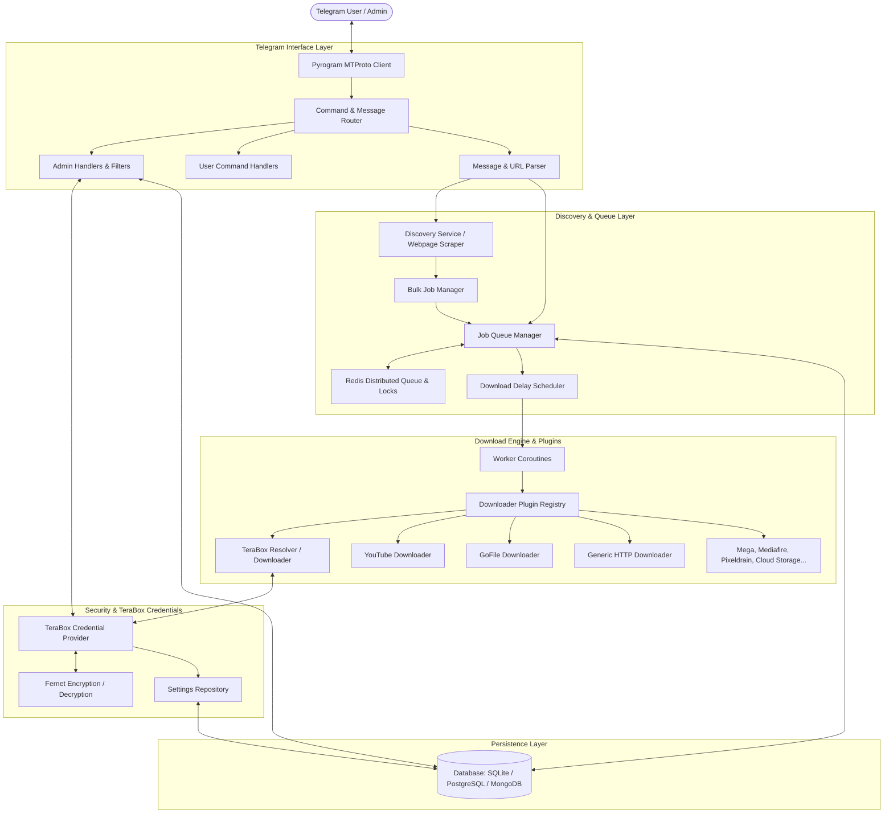

# System Architecture: Universal Link Downloader

---

## Architectural Layers

### 1. Telegram Interface Layer (`app/bot/`)
- **`client.py`**: Initializes `UniversalBot`, registers handlers, manages MTProto lifecycle, auto-recovers from locked SQLite sessions, and boots background workers.
- **`handlers/admin.py`**: Handles administrative commands (`/admin`, `/stats`, `/metrics`, `/jobs`, `/users`, `/ban`, `/auth`, `/setteraboxcookie`, `/clearteraboxcookie`, `/teraboxcookiestatus`). Manages interactive admin cookie prompt states (`_pending_cookie_admins`).
- **`handlers/messages.py`**: Intercepts direct links and webpage URLs. Dispatches single links to `job_queue` or multi-links to `bulk_manager`.
- **`handlers/commands.py`**: User commands (`/start`, `/help`, `/settings`, `/status`, `/cancel`).
- **`filters/admin.py`**: Custom Pyrogram filter checking `settings.ADMIN_IDS`.
- **`ui/`**: Keyboards, progress card templates, and dashboard formatting.

### 2. Queue & Execution Layer (`app/queue/`)
- **`manager.py` (`JobQueue`)**: Core in-memory priority queue manager. Manages concurrency semaphores, active job tracking, cancellation events, and user job quotas.
- **`scheduler.py` (`DownloadScheduler`)**: Enforces global and per-worker inter-file delays (`DOWNLOAD_FILE_DELAY`) across all download channels.
- **`redis_queue.py` (`RedisQueueManager`)**: Optional distributed Redis queue for horizontal multi-worker clusters (`HIGH`, `NORMAL`, `LOW` priority lists, distributed URL locks, heartbeat registration, and job leasing).
- **`bulk_manager.py` (`BulkJobManager`)**: Manages batch multi-file downloads discovered from articles and webpages.

### 3. Service Downloader Plugins (`app/downloaders/`)
- **`base.py`**: Defines `BaseDownloader` abstract base class and data contracts (`FileMetadata`, `ResolvedURL`, `DownloadResult`).
- **`registry.py`**: Dynamic prioritized plugin registry matching URLs against domain patterns.
- **`terabox/`**: Modular TeraBox engine:
  - `detector.py`: Matches 18+ mirror domains, extracts shorturls (`surl`), passwords (`pwd`), and normalizes URLs.
  - `resolver.py`: Multi-phase resolution (cookie-free primary path, embedded HTML state extraction, official APIs, and public gateway fallbacks). Coalesces simultaneous requests for the same share link.
  - `credentials.py`: Dynamic runtime credential provider (`TeraBoxCredentialProvider`). Manages encrypted persistence in DB, runtime cache invalidation, and session health verification.
  - `client.py`: aiohttp client with bounded exponential backoff, jitter, and automatic session invalidation on authentication failure.
  - `downloader.py`: Integrates resolver and handles 1-time re-resolution for expired direct download links.
- **`youtube.py`**: yt-dlp integration for video, audio, playlist, and channel streams.
- **`gofile/`**: GoFile dynamic content resolver, CDN location finder, and WT token generator.
- **`generic.py`**: Streaming chunk downloader with range header resume support.

### 4. Database Layer (`app/database/`)
- **`database.py`**: Multi-engine driver supporting SQLite (`aiosqlite`), PostgreSQL (`asyncpg`), and MongoDB (`motor`).
- **`models.py`**: Dataclasses for `User`, `DownloadJob`, `BotStats`, `BotSetting`.
- **`repository.py`**: Repository layer with:
  - `UserRepository`: User registration, whitelist status, ban management.
  - `JobRepository`: Job state updates, daily completion metrics, active job queries.
  - `StatsRepository`: Global aggregated statistics.
  - `SettingsRepository`: Atomic key-value persistence for configuration and encrypted credentials (`bot_settings`).

### 5. Security & Utilities (`app/core/`, `app/utils/`)
- **`crypto.py`**: Fernet authenticated symmetric encryption/decryption at rest.
- **`logging.py`**: `SecretMaskingFilter` redacting bot tokens, passwords, cookies (`ndus`, `TSID`, `csrfToken`, `terabox_cookie`), and authorization headers.
- **`security.py`**: SSRF protection, IP/subnet blocking, DNS rebinding defense.
- **`rate_limit.py`**: Sliding window per-user request throttling.
