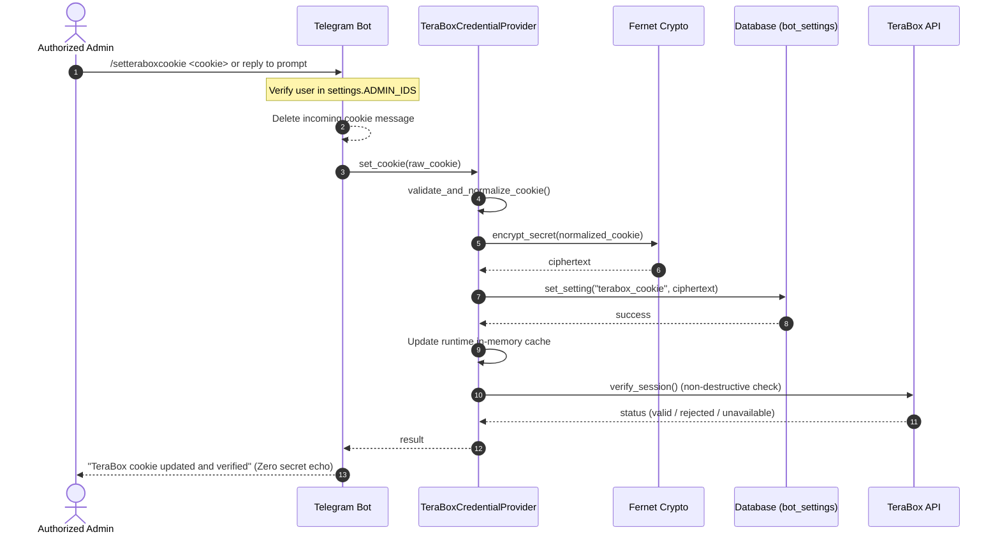

# Operational Workflows: Universal Link Downloader

## 1. Single URL Download Workflow
1. **Message Reception:** User sends a direct download link or media URL to the bot.
2. **Access & Rate Limit Check:**
   - Verify user is not banned (`user_repo.get_by_telegram_id`).
   - If `PRIVATE_MODE=True`, verify user is in `ADMIN_IDS` or whitelisted.
   - If `FORCE_SUB_CHANNEL` configured, verify user membership.
   - Verify sliding-window rate limit is not exceeded.
3. **SSRF Pre-Validation:** Ensure target URL is not pointing to private, loopback, link-local, or cloud metadata IPs.
4. **Queue Submission:**
   - Create `DownloadJob` in database with status `QUEUED`.
   - Send initial status card in chat.
   - Submit job to `JobQueue` (or Redis priority queue if clustered).
5. **Resolution & Download:**
   - Match URL against `registry`.
   - Downloader resolves direct download URL and file metadata (`filename`, `filesize`, `mime_type`).
   - Worker streams chunks into isolated directory (`downloads/<job_id>/`), calculating smoothed speed and editing progress bar at throttled intervals.
6. **Upload to Telegram:**
   - Stream or upload file to Telegram chat as `DOCUMENT` or `MEDIA` according to user setting.
   - Forward copy to `BACKUP_CHANNEL_ID` if configured.
   - Update job status to `COMPLETED` in database.
   - Clean up temporary files in `finally` block.

---

## 2. TeraBox Resolution & Dynamic Credential Workflow
1. **URL Detection:** Link matched across 18+ TeraBox mirror domains, normalized into `surl` and `pwd`.
2. **Request Coalescing:** If another coroutine is already resolving the same `surl`, join the in-flight task to eliminate duplicate network calls.
3. **Primary Resolution (Cookie-Free):**
   - Attempt Phase 1 (Web share HTML scraping & embedded JSON state).
   - Attempt Phase 2 (Official `/share/list` & `/api/download` endpoints).
   - Attempt Phase 3 (Public gateway fallbacks).
   - If direct URL is resolved, validate against SSRF and return.
4. **Secondary Resolution (Authenticated Fallback):**
   - If cookie-free resolution indicates authentication/restricted link and `terabox_credentials.has_cookie` is True:
   - Retrieve active decrypted cookie (Precedence: Database > Environment).
   - Re-execute resolution with `Cookie` header.
5. **Expired Direct URL Recovery:**
   - If the direct CDN link returns HTTP 401/403/404/410 during downloading, trigger a 1-time re-resolution to obtain a fresh direct URL.

---

## 3. Admin Dynamic Cookie Management Workflow

---

## 4. Bulk Webpage Discovery & Recursive Scraping Workflow
1. **Input Detection:** User sends a webpage URL (e.g. Graph.org) or multiple URLs in one message.
2. **Page Crawling:** `DiscoveryService` fetches HTML with concurrency and size limits (`MAX_PAGE_SIZE_MB`), extracting all anchor links recursively up to `MAX_DISCOVERY_DEPTH`.
3. **Filter & Deduplication:** Filters links against supported services in `registry` and eliminates duplicates.
4. **Execution:** `BulkJobManager` coordinates sequential or bounded concurrent processing of discovered links, tracking individual and aggregate progress.

---

## 5. Download Delay Scheduling (`DownloadScheduler`)
- Enforces a minimum cooldown delay (`DOWNLOAD_FILE_DELAY`, default 10s) between consecutive completed/failed download jobs.
- Standalone mode: Coordinated in-memory via `DownloadScheduler`.
- Clustered mode: Coordinated across all worker nodes via Redis timestamp key (`global:last_job_finished_time`).
